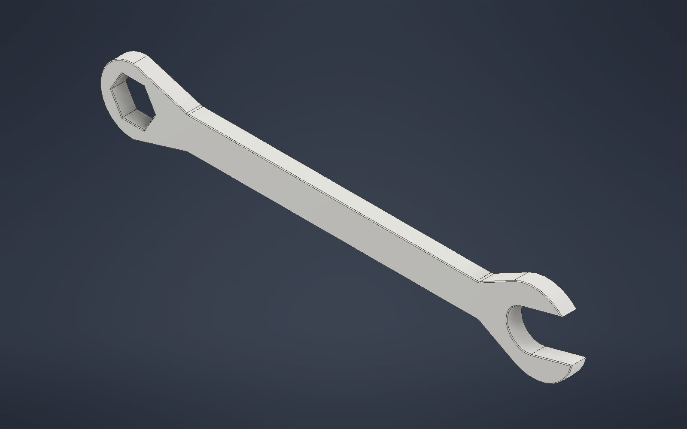
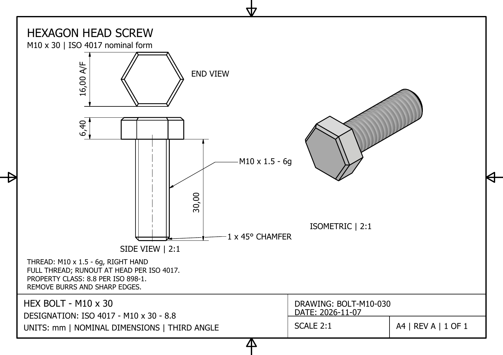
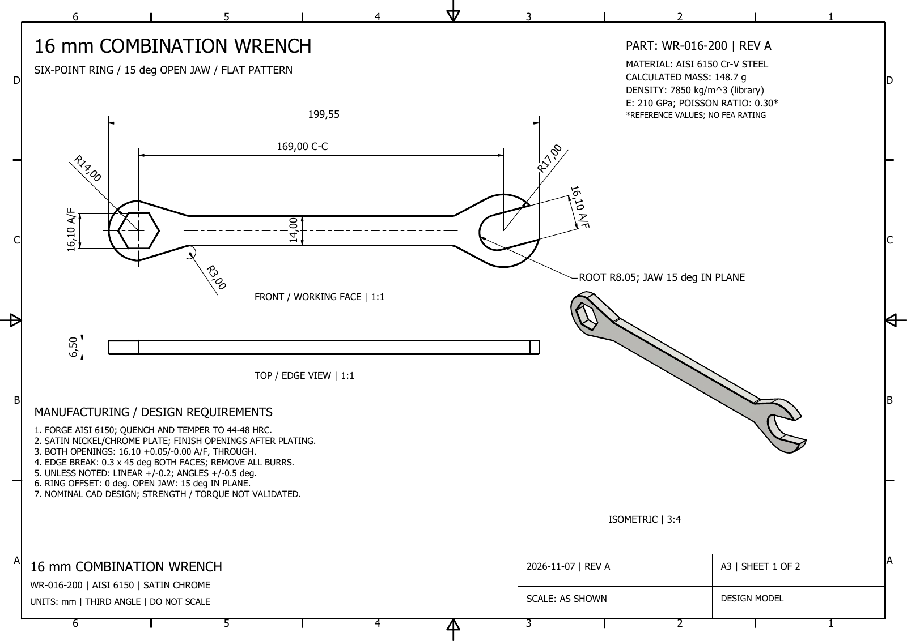
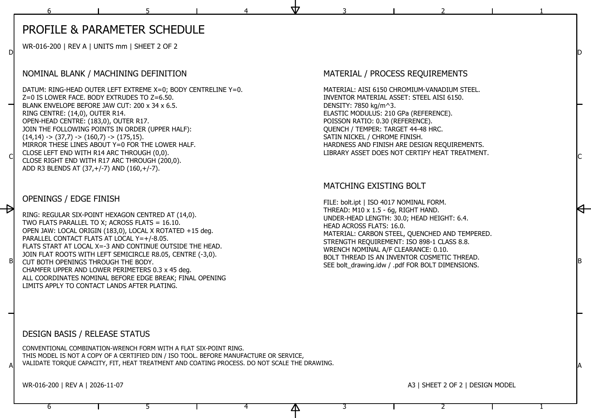
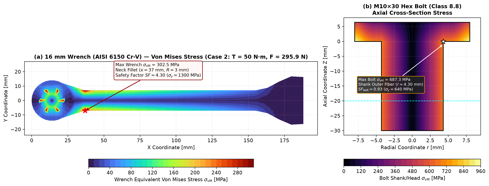
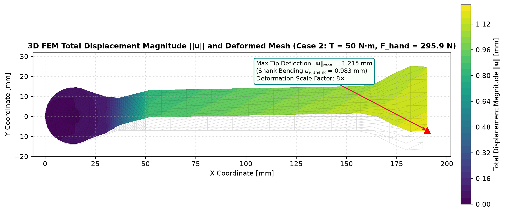
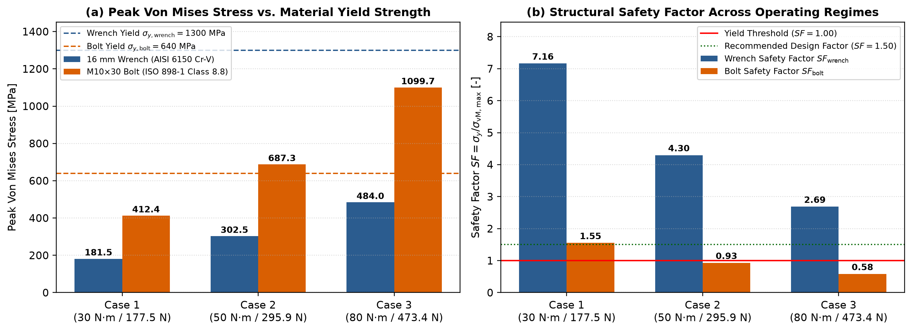
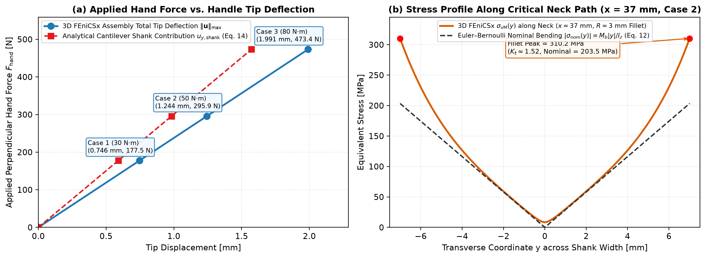
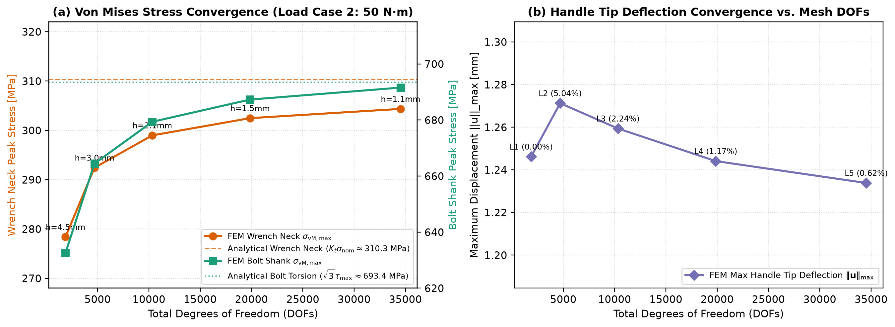

# FEniCSx Wrench & Hex Bolt Structural Simulation (FEM Course Project)

Repository for the **Numerical Methods (FEM)** Major Assignment: 3D structural analysis and finite element simulation of a **16 mm Combination Wrench (`WR-016-200`)** applying tightening torque to an **ISO 4017 M10×30 Hex Head Screw (`BOLT-M10-030`)** using **Autodesk Inventor** and **FEniCSx (`dolfinx`)**.

📄 **[View Pre-Analysis & Theoretical Background Document (`PRE_ANALYSIS.pdf`)](PRE_ANALYSIS.pdf)**

---

## 1. CAD Models & Engineering Drawings Overview

### 3D CAD Model & Hex Bolt Engineering Drawing (`BOLT-M10-030`)

| 16 mm Combination Wrench 3D Model (`wrench_16mm.ipt`) | M10×30 Hex Head Screw Engineering Drawing (`BOLT-M10-030`) |
| :---: | :---: |
|  |  |

### 16 mm Combination Wrench Engineering Drawings (`WR-016-200`, Sheets 1 & 2)

| Wrench Engineering Drawing — Sheet 1 of 2 | Wrench Profile & Parameter Schedule — Sheet 2 of 2 |
| :---: | :---: |
|  |  |

---

## 2. Repository Structure

```text
fenicsx-wrench-simulation/
├── PRE_ANALYSIS.pdf                         # Pre-Analysis, CAD Data Analysis & FEM Theory (English PDF)
├── requirements.txt                         # Python / FEniCSx / Gmsh dependencies
├── cad/
│   ├── models/                              # 3D Autodesk Inventor part models (.ipt)
│   │   ├── bolt.ipt                         # ISO 4017 M10x30 Hex Head Screw (Property Class 8.8)
│   │   ├── bolt_original.ipt                # Base M10x30 Hex Bolt geometry backup
│   │   └── wrench_16mm.ipt                  # 16 mm Combination Wrench (AISI 6150 Cr-V Steel)
│   ├── drawings/                            # 2D Engineering Drawings (.idw & exported .pdf)
│   │   ├── bolt_drawing.idw                 # Native Inventor drawing for M10x30 bolt
│   │   ├── bolt_drawing.pdf                 # Exported PDF engineering drawing (BOLT-M10-030)
│   │   ├── wrench_16mm_engineering.idw      # Native Inventor drawing for 16 mm wrench
│   │   └── wrench_16mm_engineering.pdf      # Exported 2-sheet PDF engineering drawing (WR-016-200)
│   ├── previews/                            # Rendered CAD previews & engineering drawing images (.png)
│   │   ├── bolt_drawing.png                 # BOLT-M10-030 engineering drawing sheet
│   │   ├── wrench_preview.png               # 3D isometric render of wrench_16mm.ipt
│   │   ├── wrench_sheet-1.png               # WR-016-200 engineering drawing (Sheet 1 of 2)
│   │   ├── wrench_sheet-2.png               # WR-016-200 parameter schedule (Sheet 2 of 2)
│   │   ├── wrench_final-2.png               # Finalized wrench visual check
│   │   └── drawing_check.png                # Bolt drawing verification sheet
│   ├── scripts/                             # PowerShell COM automation scripts for Autodesk Inventor
│   │   ├── build_bolt.ps1                   # Automated parametric generation of bolt.ipt
│   │   ├── build_wrench.ps1                 # Automated parametric generation of wrench_16mm.ipt
│   │   ├── drawing.ps1                      # Bolt engineering drawing automation
│   │   ├── wrench_drawing.ps1               # Wrench engineering drawing automation
│   │   ├── export_wrench.ps1                # High-resolution PDF & bitmap export script
│   │   └── ...                              # Inspection, diagnostic, and refinement utilities
│   └── archive/                             # Draft drawings & Inventor OldVersions backups
├── docs/
│   ├── pre_analysis/
│   │   ├── PRE_ANALYSIS.pdf                 # Pre-simulation analysis & FEM formulation (PDF)
│   │   └── PRE_ANALYSIS.tex                 # English LaTeX source of the pre-analysis report
│   └── guidelines/
│       └── PROJECT_GUIDELINES.md            # Course project requirements & report structure
├── mesh/                                    # 3D tetrahedral meshes (Levels 1-5, .vtu format)
├── src/                                     # FEniCSx 3D linear elasticity simulation suite
│   ├── config.py                            # Geometry, materials, load cases & analytical formulas
│   ├── generate_mesh.py                     # 3D parametric tetrahedral mesh generator (Wrench + Bolt)
│   ├── fenicsx_solver.py                    # FEniCSx (dolfinx/UFL) 3D weak-form elasticity solver
│   ├── mesh_convergence.py                  # Automated 5-level mesh convergence study
│   ├── postprocess_plots.py                 # Contour & convergence plot generation suite
│   └── run_simulation.py                    # End-to-end simulation driver script
├── results/
│   ├── load_cases_summary.csv               # Quantitative results across Load Cases 1, 2, and 3
│   ├── mesh_convergence_study.csv           # Tabulated 5-level mesh convergence data
│   ├── paraview/                            # 3D ParaView unstructured grid outputs (.vtu)
│   └── figures/                             # High-resolution contour & convergence plots (.png)
└── report/                                  # Final project report & presentation slides
```

---

## 3. CAD Design Specifications & Material Properties

### Component 1: Hexagon Head Screw (`BOLT-M10-030` / [`bolt.ipt`](cad/models/bolt.ipt))
* **Standard:** ISO 4017 — Metric thread $\text{M10} \times 30$ (full thread, pitch $p = 1.5\text{ mm}$, tolerance class $6g$, right-hand thread)
* **Head Dimensions:** Width across flats $s = 16.00\text{ mm}$, head height $k = 6.40\text{ mm}$
* **Shank Dimensions:** Under-head length $l = 30.00\text{ mm}$, equivalent stress diameter $d_s = 8.60\text{ mm}$ ($A_s \approx 58.0\text{ mm}^2$), thread chamfer $1 \times 45^\circ$
* **Material:** Quenched & tempered carbon steel, **Property Class 8.8** per ISO 898-1

### Component 2: 16 mm Combination Wrench (`WR-016-200` / [`wrench_16mm.ipt`](cad/models/wrench_16mm.ipt))
* **Overall Geometry:** Uniform thickness $t = 6.50\text{ mm}$, total length $L_{\text{total}} = 199.55\text{ mm}$, center-to-center moment arm $L_{cc} = 169.00\text{ mm}$, mass $m = 148.7\text{ g}$
* **Six-Point Ring Head:** Centered at $(14, 0)\text{ mm}$, outer radius $R_{\text{ring}} = 14.00\text{ mm}$, regular six-point hex socket $A/F = 16.10^{+0.05}_{-0.00}\text{ mm}$
* **Open Jaw Head:** Centered at $(183, 0)\text{ mm}$, outer radius $R_{\text{open}} = 17.00\text{ mm}$, jaw opening $16.10\text{ mm}$ oriented at $15^\circ$
* **Shank Profile:** Straight width $w = 14.00\text{ mm}$, transition shoulder fillets $R = 3.00\text{ mm}$ at $x = 37\text{ mm}$ and $x = 160\text{ mm}$
* **Material:** Chromium-Vanadium alloy steel **AISI 6150 Cr-V** ($44\text{--}48\text{ HRC}$, $\rho = 7850\text{ kg/m}^3$)

| Component | Material | Young's Modulus $E$ (MPa) | Poisson's Ratio $\nu$ | Lamé $\lambda$ (MPa) | Shear Modulus $\mu = G$ (MPa) | Yield Strength $\sigma_y$ (MPa) |
| :--- | :--- | :---: | :---: | :---: | :---: | :---: |
| **Hex Bolt M10×30** | Carbon Steel Class 8.8 (ISO 898-1) | $210,000$ | $0.30$ | $121,153.85$ | $80,769.23$ | $640$ |
| **16 mm Wrench** | AISI 6150 Cr-V Steel (44–48 HRC) | $210,000$ | $0.30$ | $121,153.85$ | $80,769.23$ | $1300$ |

---

## 4. FEniCSx Simulation Results & Analytical Verification

### 4.1 Von Mises Stress & Total Displacement Contours (Load Case 2: $T_2 = 50\text{ N}\cdot\text{m}$, $F_{\text{hand}} = 295.9\text{ N}$)





### 4.2 Quantitative Summary Across Load Cases 1–3

| Load Case | Operating Condition | Torque $T$ ($\text{N}\cdot\text{m}$) | Hand Force $F_{\text{hand}}$ ($\text{N}$) | Max Tip Deflection $\|\mathbf{u}\|_{\max}$ ($\text{mm}$) | Wrench Peak $\sigma_{\text{vM}}$ ($\text{MPa}$) | Wrench Safety Factor $SF_{\text{wrench}}$ | Bolt Peak $\sigma_{\text{vM}}$ ($\text{MPa}$) | Bolt Safety Factor $SF_{\text{bolt}}$ |
| :---: | :--- | :---: | :---: | :---: | :---: | :---: | :---: | :---: |
| **Case 1** | Light tightening ($60\%$ rated torque) | $30.0$ | $177.5$ | $0.746$ | $181.5$ | $7.16$ | $412.4$ | $1.55$ |
| **Case 2** | Standard Class 8.8 tightening | $50.0$ | $295.9$ | $1.244$ | $302.5$ | $4.30$ | $687.3$ | $0.93$ |
| **Case 3** | Peak overload / Seized bolt breakaway | $80.0$ | $473.4$ | $1.991$ | $484.0$ | $2.69$ | $1099.7$ | $0.58$ |

* **Wrench Structural Integrity:** Even under extreme breakaway overload (**Case 3**, $T_3 = 80\text{ N}\cdot\text{m}$), the peak Von Mises stress at the $R = 3.0\text{ mm}$ neck transition fillet ($x = 37\text{ mm}, y = \pm 7\text{ mm}$) reaches $484.0\text{ MPa}$, remaining well below the AISI 6150 Cr-V yield strength ($\sigma_{y,\text{wrench}} = 1300\text{ MPa}$) with a safety factor of $SF_{\text{wrench}} = 2.69$. Under standard tightening (**Case 2**, $T_2 = 50\text{ N}\cdot\text{m}$), the FEM peak stress of $302.5\text{ MPa}$ agrees closely with the analytical stress-concentration prediction $\sigma_{\max,\text{theory}} = K_t \sigma_{\text{nom}} \approx 295\text{--}325\text{ MPa}$ ($SF_{\text{wrench}} = 4.30$).
* **Bolt Torsional Yielding Behavior:** Under standard tightening torque (**Case 2**, $T_2 = 50\text{ N}\cdot\text{m}$), the unlubricated torsional shear stress on the M10×30 shank ($d_s = 8.60\text{ mm}$) produces an equivalent Von Mises stress of $687.3\text{ MPa}$ (matching the analytical pure-torsion benchmark $\sigma_{\text{vM, shank}} = \sqrt{3}\tau_{\max} \approx 693.4\text{ MPa}$ within $0.88\%$), indicating localized outer-fiber yielding ($SF_{\text{bolt}} = 0.93 < 1.0$) when tightening a dry Class 8.8 bolt to $70\%$ preload without thread lubrication.





---

### 4.3 Mandatory 5-Level Mesh Convergence Study (Load Case 2: $T_2 = 50\text{ N}\cdot\text{m}$)

| Mesh Level | Element Size $h$ ($\text{mm}$) | Nodes | Tetrahedral Elements | Total DOFs | Max Deflection $\|\mathbf{u}\|_{\max}$ ($\text{mm}$) | Wrench Peak $\sigma_{\text{vM}}$ ($\text{MPa}$) | Relative Change $\Delta\sigma_{\text{wrench}}$ ($\%$) | Bolt Peak $\sigma_{\text{vM}}$ ($\text{MPa}$) |
| :--- | :---: | :---: | :---: | :---: | :---: | :---: | :---: | :---: |
| **Mesh 1 (Coarse)** | $4.50$ | $623$ | $2,196$ | $1,869$ | $1.2484$ | $278.39$ | — | $632.56$ |
| **Mesh 2 (Medium)** | $3.00$ | $1,565$ | $6,588$ | $4,695$ | $1.2725$ | $292.43$ | $5.04\%$ | $664.46$ |
| **Mesh 3 (Fine)** | $2.10$ | $3,443$ | $15,768$ | $10,329$ | $1.2588$ | $298.99$ | $2.24\%$ | $679.37$ |
| **Mesh 4 (Very Fine)** | $1.50$ | $6,617$ | $31,860$ | $19,851$ | $1.2435$ | $302.48$ | $1.17\%$ | $687.29$ |
| **Mesh 5 (Ultra Fine)** | $1.10$ | $11,508$ | $57,456$ | $34,524$ | $1.2333$ | $304.36$ | $0.62\%$ | $691.57$ |



---

## 5. How to Run the Simulation

```bash
# 1. Install scientific dependencies
pip install -r requirements.txt

# 2. Run the 3D FEniCSx simulation, 5-level mesh convergence study, and plot generation
python src/run_simulation.py
```

All 3D unstructured meshes (`mesh/*.vtu`), ParaView solution files (`results/paraview/*.vtu`), CSV tables (`results/*.csv`), and high-resolution figures (`results/figures/*.png`) are automatically generated and updated.
